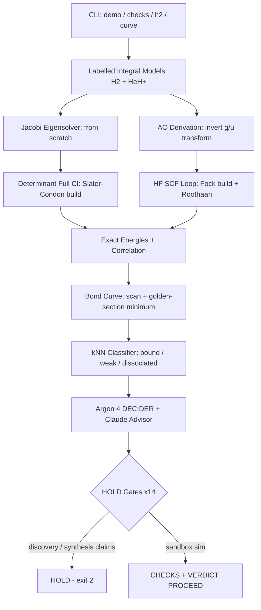
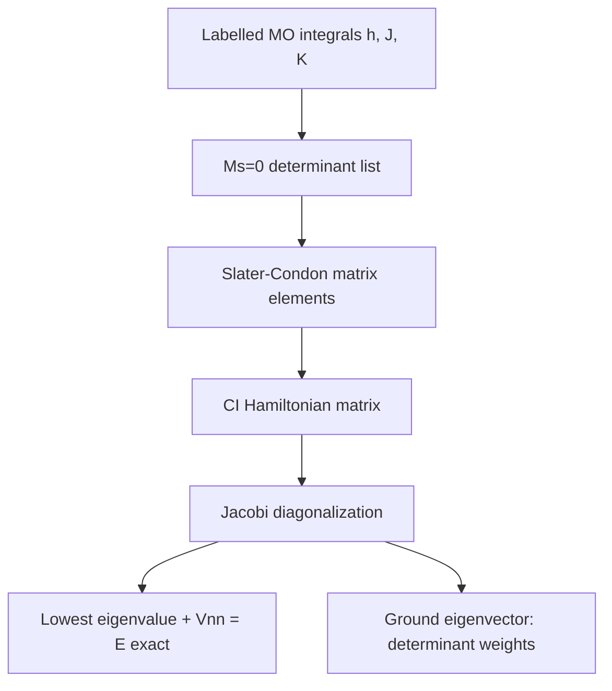
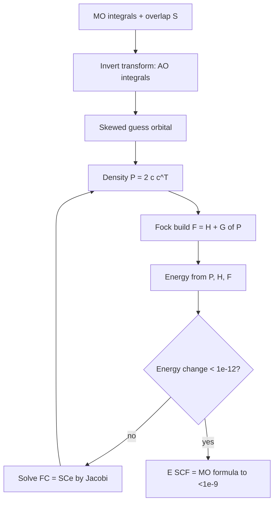
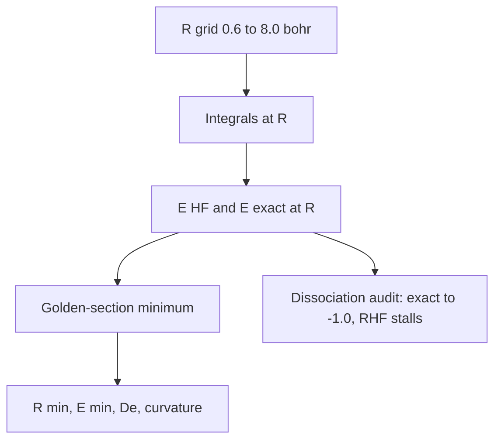
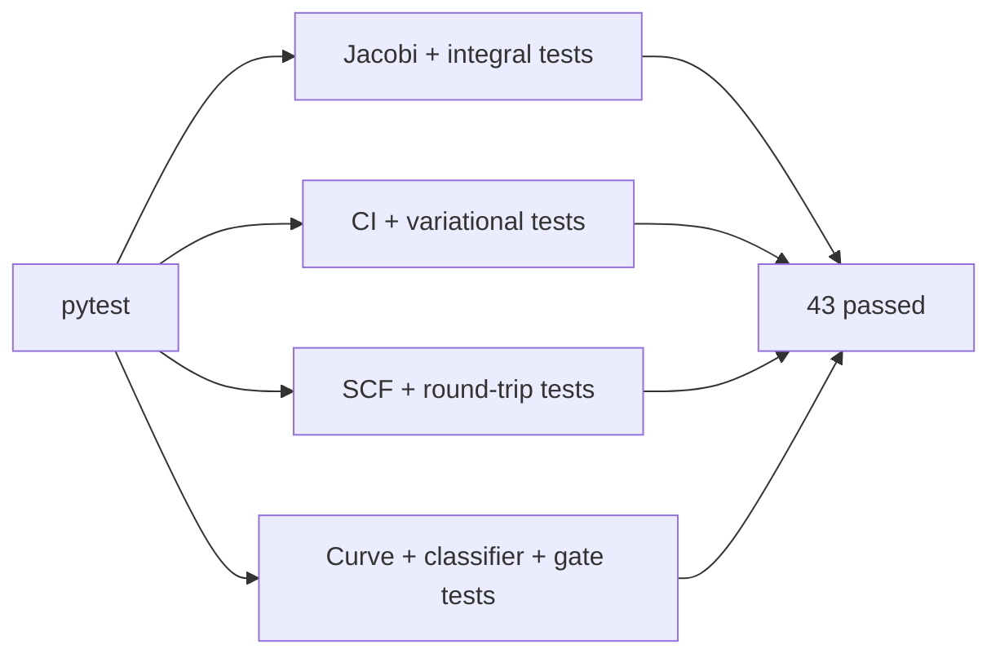
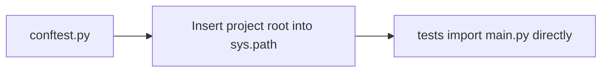
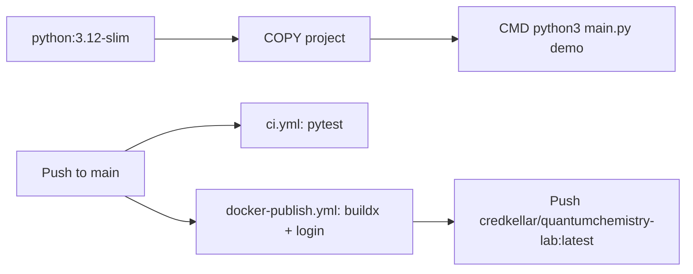

# QuantumChemistry-Lab ⚛️🧪

**Quantum Chemistry Method Lab** — by Darion Kellar

QuantumChemistry-Lab is an **educational quantum chemistry lab** in ONE pure-Python file. It builds small molecular Hamiltonians for **H₂ and HeH⁺** in a minimal basis, solves them **exactly** by determinant full-CI diagonalization (with a from-scratch Jacobi eigensolver — no numpy), runs a **Hartree–Fock SCF loop** on the same Hamiltonian by a second, independent route, scans the **bond-length curve** to its minimum, and names the gap between the two answers what it is: the **correlation energy**.

The honest scope is the whole point, and it is stated everywhere:

- ✅ **What is exact:** every energy is the exact answer *for the toy Hamiltonian* — the CI is a complete diagonalization, the SCF is a real Roothaan loop, and the checks assert the two routes agree.
- 🚫 **What is not claimed:** ab initio chemistry. The integrals are **labelled textbook-class parameters** (minimal-basis / STO-3G ranges), *not* computed from basis functions. Real-world reference values appear only in the basis-set table, flagged **LABELLED published-class**.

Every drug / materials discovery, weapons, explosives, synthesis-guidance, and production claim sits behind a permanent HOLD gate (14 total). 🔒

[](https://github.com/kimanicollier44-cmyk/QuantumChemistry-Lab/actions/workflows/ci.yml)
[](https://github.com/kimanicollier44-cmyk/QuantumChemistry-Lab/actions/workflows/docker-publish.yml)

> ℹ️ These are the **live** workflow badges for this repo. They activate as soon as the `ci.yml` and `docker-publish.yml` files from the paste pack are pasted into `.github/workflows/` — until then they have nothing to report yet.

## 🧰 Tech Stack Badges & Full Architecture Tech Stack

### 💻 Core Programming Languages & Core Systems


- 🐍 Python 3.12, pure standard library (`math`, `hashlib`, `json`, `sys`) — zero dependencies, zero network, deterministic (double-run byte-identical)
- 🔢 Jacobi eigenvalue algorithm implemented from scratch: every diagonalization in the lab — CI matrices, the overlap matrix, the Fock matrix — goes through it, and the tests check it against known eigenvalues, orthonormality, and full matrix reconstruction
- 🧬 Determinant full CI: all Ms = 0 Slater determinants (4 for the 2-orbital model, 9 for the 3-orbital model), Hamiltonian built by the Slater–Condon rules from the labelled MO integrals
- 🔁 Hartree–Fock SCF in the AO basis: Fock build `F = H + G(P)`, Roothaan equation solved by symmetric orthogonalization, iterated from a deliberately skewed guess until the energy stops moving at 1e-12
- 🏷️ Labelled integral models: smooth R-dependent functions anchored to textbook-class minimal-basis values (H₂ overlap S(1.4) = 0.6592 vs the STO-3G-class 0.6593), with correct dissociation limits built in
- 🧠 TinyML kNN bond classifier (from scratch, stdlib): bound / weak / dissociated from (R, energy above minimum, curvature), labels generated by the model itself
- 🪑 Council seats: Gemini Argon 4 DECIDER (names-only, tighten-only) + Muse advisor (never overrides HOLD) + Google Flow plan-only (rendered = False, live = 0)

### ⛓️ Web3 & Infrastructure

- 🚫 **Not applicable — honestly.** No blockchain, no Web3, no tokens: the "infrastructure" here is one offline Python file, a determinant list, and a rotation loop. No fake badges here.

### ⚙️ Platform Support & Hardware Architecture


- 🖥️ Pure Python — runs anywhere Python 3.12+ runs (Linux, macOS, Windows), plus the `python:3.12-slim` Docker image
- 🔒 No real laboratory, instrument, or synthesis system is touched, ever: discovery and synthesis uses are permanent HOLD gates (see the gate table below)

### ⚡ Low-Level Infrastructure & Performance

- 🚫 **No low-level code — honestly.** No C, no C++, no GPU, no numpy, no compiled extensions: this is one interpreted Python file on purpose, so every integral, rotation, and Fock build can be read, checked, and diffed. Performance here means honest algorithms — cyclic Jacobi sweeps, a golden-section minimum search, and a fixed determinant basis — all deterministic and byte-identical between runs.

### 🛠️ DevOps & Build Tools


- 🐳 Docker (`python:3.12-slim`), GitHub Actions CI + Docker Publish (delivered in the paste pack)
- 🎯 Target image: `credkellar/quantumchemistry-lab:latest`
- 🧪 Tests: `pytest` (43 tests) + the built-in CHECKS suite (57 checks) in `main.py`

### ☁️ Cloud Providers

- 🚫 **None — honestly.** No cloud provider is used or needed: the lab runs fully offline on your own machine or in a local Docker container. Docker Hub appears only as the registry the publish workflow pushes the image to.

## What this does?

1. 🏷️ **Labelled integral models** — H₂ and HeH⁺ are described by smooth, R-dependent model integrals in an orthonormal MO basis (σg/σu for H₂, bonding/antibonding for HeH⁺), anchored at equilibrium to textbook-class minimal-basis values. The anchors reproduce the STO-3G-class landmarks (RHF ≈ −1.117 Eh at R = 1.4 bohr, overlap 0.6593), and the functions carry the correct dissociation limits: every two-electron integral tends to U/2 = 0.3125 Eh, so the exact curve can reach two free hydrogen atoms.
2. 🔢 **Jacobi eigensolver, from scratch** — a cyclic Jacobi rotation solver diagonalizes every symmetric matrix in the lab. It is verified like a result, not trusted like a library: known 2×2 eigenvalues (1 and 3), trace preservation, orthonormal eigenvectors, and reconstruction V Λ Vᵀ = A, all asserted.
3. 🧬 **Exact diagonalization (full CI)** — all Ms = 0 determinants over the MO basis (4 for H₂: σg², σu², and the two open-shell determinants), the Hamiltonian assembled by Slater–Condon rules. Parity does real work you can check: the σg² determinant does not couple to the open-shell determinants at all, and its coupling to σu² is exactly the exchange integral K_gu — both asserted in CHECKS.
4. ⚖️ **Hartree–Fock, priced honestly** — at the anchor geometry: **E_HF = −1.11630 Eh**, **E_exact = −1.14014 Eh**, and the difference **E_corr = −0.02385 Eh** is printed as what it is — the correlation energy, the price of the single-determinant approximation. The ground state is 97.8% σg² determinant; the rest is σu² mixing that HF cannot express.
5. 🔁 **An SCF loop that has to work** — the AO-basis integrals are *derived* from the MO model by inverting the g/u transformation (closed-form, round-trip asserted to 1e-9), then a Roothaan loop starts from a skewed guess (1.0, 0.35) and iterates the Fock build 15 times until the orbital walks itself to the symmetric bonding MO and the energy lands on the MO formula to <1e-9. Two routes, one Hamiltonian — the agreement is the validation.
6. 🎯 **Where HF *is* exact — and where it is not** — for the one-electron ion H₂⁺ the SCF problem and the exact problem are the same problem, and the lab asserts the match to 1e-10. For two-electron H₂ the match is only to within the correlation energy (asserted < 0.05 Eh, actual 0.0239): the lab states this plainly instead of rounding the gap away.
7. 📈 **The bond-length curve** — exact and HF energies from 0.6 to 8.0 bohr, a golden-section minimum at **R = 1.400 bohr = 0.741 Å** with **E = −1.14014 Eh** and dissociation energy **De = 0.14308 Eh**. Then the famous failure, computed: at 8 bohr the exact curve sits at −0.986 Eh on its way to two hydrogen atoms (−1.0), while restricted HF stalls at −0.686 Eh — its determinant keeps ionic terms alive at long range. The growing gap is static correlation, printed in the table, not hidden.
8. 💠 **HeH⁺** — the same machinery on a heteronuclear ion (Vnn = 2/R): minimum at **R = 1.463 bohr = 0.774 Å**, **E_exact = −2.94938 Eh**, E_corr = −0.02058 Eh — no new code paths, just a second labelled Hamiltonian through the same solver.
9. 🧩 **A bigger toy, a deeper gap** — adding one more virtual orbital (σg*) at R = 1.4 grows the determinant space to 9 and deepens the correlation to **−0.03385 Eh**, while the HF energy does not move at all: HF never sees the virtual orbitals; the exact solution does. That asymmetry *is* the basis-set problem, in miniature.
10. 🏷️ **Basis-set honesty table + classifier + seats + checks** — published-class rows (STO-3G → cc-pVTZ → HF limit −1.1336 → exact −1.1745) sit next to the toy's own computed row, each flagged LABELLED or COMPUTED; a from-scratch kNN labels bond lengths bound / weak / dissociated with labels generated by the model itself, watched over by the Argon 4 DECIDER (sha256 trace), Muse advisor, Google Flow plan-only, and a built-in CHECKS suite (57 checks).

## 🗺️ How it works — diagram per script

### `main.py` — the whole lab



### `main.py` § full CI — from integrals to exact energy



### `main.py` § SCF — the second route to HF



### `main.py` § bond curve — scan, minimum, dissociation



### `tests/test_main.py` — verification



### `conftest.py` — test path setup



### `Dockerfile` + CI flow — container & publish



## Why is this cool?

1. 🔢 The eigensolver is **built, not imported**: cyclic Jacobi rotations, readable line by line, and verified by reconstruction — the matrix is rebuilt from its own eigendecomposition in the tests.
2. 🧬 The CI is **complete, not sampled**: every Ms = 0 determinant is in the matrix, so "exact" means exact for the Hamiltonian on the table — and the parity block structure is asserted, not assumed.
3. 🔁 The SCF **earns** its answer: it starts from a lopsided guess and walks to the bonding orbital over 15 printed iterations, then agrees with the independent MO formula to <1e-9.
4. 💔 The lab computes the **most famous failure in quantum chemistry**: restricted HF dissociating H₂ to −0.686 Eh instead of −1.0 — not as a footnote, but as a row in its own curve table.
5. 🎯 The one case where HF is exact is **proved in code**: H₂⁺, one electron, SCF ≡ exact to 1e-10 — and the two-electron gap is then shown next to it, unrounded.
6. 🧩 Correlation is **basis-hungry, visibly**: one extra virtual orbital deepens E_corr from −0.0239 to −0.0339 Eh while HF sits perfectly still — the whole basis-set problem in one comparison.
7. 🏷️ The labels are **load-bearing**: integrals say LABELLED, reference rows say LABELLED published-class, the toy row says COMPUTED — a reader can always tell which kind of number they are holding.
8. 🔄 The AO↔MO round trip is **asserted to 1e-9**: the SCF and the CI provably solve the same Hamiltonian, so their agreement is a theorem about the code, not a hope.
9. 📈 The minimum is **found, not quoted**: a golden-section search locates R = 1.400 bohr from the curve itself, with the curvature at the minimum checked positive.
10. 🎯 Deterministic end to end: run it twice, get byte-identical output — a chemistry lab you can diff.

## What problems this solves?

1. ❌ **Problem:** "Quantum chemistry" demos that call a black-box library and print whatever comes out. ✅ **Solution:** The eigensolver, the CI build, and the SCF loop are all in the one file, in the open, each verified against independent anchors.
2. ❌ **Problem:** Hartree–Fock presented as "the answer" with no error bar. ✅ **Solution:** The exact diagonalization of the same Hamiltonian sits next to HF in every report, and the gap is named, signed, and asserted into a range.
3. ❌ **Problem:** Students told "HF fails at dissociation" without ever seeing it fail. ✅ **Solution:** The curve table shows the exact energy reaching −0.986 Eh at 8 bohr while RHF stalls at −0.686 — the failure is a number, not a slogan.
4. ❌ **Problem:** Toy models quietly dressed up as ab initio results. ✅ **Solution:** The docstring, the demo's first section, the README, and a dedicated HOLD gate (`toy_model_as_measurement_claim`) all state the integrals are labelled parameters.
5. ❌ **Problem:** SCF loops that "converge" because nobody checks against anything. ✅ **Solution:** The AO integrals are derived from the MO model and round-tripped to 1e-9; the SCF energy must match the MO formula to <1e-9 or the checks fail.
6. ❌ **Problem:** Correlation energy used as a buzzword. ✅ **Solution:** It is defined as E_exact − E_HF for the same Hamiltonian, computed at every grid point, and shown growing from −0.00001 Eh at 0.6 bohr to −0.29989 Eh at 8 bohr.
7. ❌ **Problem:** Basis-set tables that mix computed and literature numbers without marking them. ✅ **Solution:** Every row is flagged LABELLED published-class or COMPUTED here, and the table is asserted monotone toward the HF limit and the exact energy — which no row may cross.
8. ❌ **Problem:** "HF is exact for small systems" repeated loosely. ✅ **Solution:** The lab pins the true statement — exact for one-electron systems (asserted on H₂⁺ to 1e-10) — and shows the two-electron case missing by the correlation energy.
9. ❌ **Problem:** Chemistry tools that need a compiled stack, a licence, or a cluster. ✅ **Solution:** One offline Python file; Jacobi rotations and determinant lists run anywhere Python 3.12 runs.
10. ❌ **Problem:** Educational models that only show the happy path. ✅ **Solution:** The lab deliberately exercises the uncomfortable results — the wrong RHF dissociation limit, the HF/exact gap, the basis hunger — each as a first-class, asserted output.

## How to install this?

1. 📋 Clone or download this project folder:

```bash
git clone https://github.com/kimanicollier44-cmyk/QuantumChemistry-Lab.git
```

2. 🐍 Make sure Python 3.12+ is installed: `python3 --version`
3. ▶️ Run the full demo + checks (no arguments needed):

```bash
python3 main.py
```

4. 🧪 Run the test suite:

```bash
pip install pytest
python3 -m pytest -q
```

5. 🎛️ Try the other commands:

```bash
python3 main.py checks    # 57 built-in checks
python3 main.py h2        # H2 at the anchor geometry: integrals, HF, exact, correlation
python3 main.py curve     # bond-length curve + minimum + dissociation audit
python3 main.py scf       # the SCF loop, full iteration trace as JSON
python3 main.py basis     # basis-set honesty table (labelled rows + computed toy row)
python3 main.py classify  # kNN bond classifier report
python3 main.py brains    # Argon 4 + Muse + Flow seats
python3 main.py holds     # list all 14 HOLD gates
python3 main.py hold-demo # exits 2 - gated actions stay HOLD
```

6. 🐳 Or run it in Docker:

```bash
docker pull credkellar/quantumchemistry-lab:latest
docker run --rm credkellar/quantumchemistry-lab:latest
```

## Requirements

- 🐍 Python 3.12 or newer
- 📦 Dependencies: **none** (standard library only)
- 🌐 Network: **none** — fully offline
- 🧪 For tests only: `pytest`
- 🐳 Optional: Docker

## FULL project structure tree

```text
quantumchemistry-lab/
├── main.py                  # the whole lab: Jacobi eigensolver, labelled integrals, determinant CI, SCF loop, bond curve, basis table, classifier, seats, HOLD gates
├── conftest.py              # puts the project root on sys.path for tests
├── tests/
│   └── test_main.py         # 43 pytest tests: Jacobi, integrals, CI, SCF, curve, HeH+, basis table, classifier, gates, seats
├── assets/
│   └── cover.png            # README cover image (2736 x 912)
├── .github/
│   └── workflows/
│       ├── ci.yml           # paste-in from the workflow pack
│       └── docker-publish.yml # paste-in from the workflow pack (tag: credkellar/quantumchemistry-lab:latest)
├── Dockerfile               # python:3.12-slim, runs the demo
├── .gitignore               # __pycache__/, .pytest_cache/, *.pyc
└── README.md                # this file
```

> 📦 Delivered separately as paste packs (not in this tree): `.github/workflows/ci.yml` + `docker-publish.yml`, and the Docker Hub pack (100-char description, 350-char About, overview, categories).

## 🔒 HOLD gates — all 14, permanent

| # | Gate | What stays held |
|---|------|-----------------|
| 1 | `drug_discovery_claim` | No real drug or pharmaceutical discovery claims from a toy Hamiltonian |
| 2 | `materials_discovery_claim` | No real materials discovery claims; a labelled model discovers nothing |
| 3 | `weapons_chemistry_guidance` | No weapons chemistry of any kind |
| 4 | `explosives_synthesis_guidance` | No synthesis guidance for explosives or energetic materials |
| 5 | `real_lab_synthesis_guidance` | No real laboratory synthesis instructions or procedures |
| 6 | `toxic_compound_design` | No designing, optimising, or evaluating toxic compounds |
| 7 | `production_quantum_chemistry_claim` | No production or industrial quantum-chemistry claims |
| 8 | `ab_initio_accuracy_claim` | No claiming ab initio accuracy; the integrals are labelled parameters, not computed ones |
| 9 | `real_molecule_prediction_claim` | No predicting a real molecule's properties for any real decision |
| 10 | `patent_discovery_claim` | No patent, novelty, or discovery claims from lab output |
| 11 | `chemical_safety_certification` | No certifying any real compound safe, stable, or compliant |
| 12 | `environmental_release_claim` | No environmental fate, persistence, or release claims |
| 13 | `human_exposure_guidance` | No human exposure, dose, or health guidance |
| 14 | `toy_model_as_measurement_claim` | Toy-model numbers must never be presented as measured or ab initio data |

🧑‍⚖️ **Council seats:** Gemini Argon 4 Extended Thinking — DECIDER (names-only, tighten-only, MAP → MODEL → STRESS → DECIDE, sha256 trace, `can_override_hold = False`) · Muse — advisor (`can_override_hold = False`) · Google Flow — plan-only (`rendered = False`, `live = 0`).

✅ **Verification:** pytest **43 passed** (project + clean copy) · built-in CHECKS **57/57** · double-run output **byte-identical** · `hold-demo` exits **2** · `main.py` **1,039 lines**, pure stdlib, zero network.

## 🧒 5th-grade English section

Imagine two hydrogen atoms holding hands. How tightly they hold, and how far apart they like to stand, decides almost everything about them. This lab does that math on a computer — with training wheels, on purpose. 🤝

- **Atoms like a favourite distance.** Too close and they push away; too far and the holding-hands force fades. For hydrogen the favourite distance is about **0.74 ångström** — much thinner than a hair. The lab draws the whole "energy hill" and finds the bottom of the valley by itself. ⛰️
- **There are two ways to do the math.** The quick way (called Hartree–Fock) pretends each electron moves in a smooth average cloud made by the other one. The careful way checks *every* arrangement of the electrons at once. The careful way always wins a little — and the size of that little win has a name: **correlation energy**. 📏
- **The quick way makes a famous mistake.** Pull the two atoms far apart and the quick math says letting go costs way more than it really does — it is still secretly imagining the atoms sharing electrons they no longer share. The careful math lets go properly. The lab shows both numbers side by side so you can watch the mistake happen. 🎭
- **The lab is honest about being a toy.** Real chemistry software *measures* its starting numbers from the atoms themselves. This lab uses practice numbers that are labelled as practice numbers, picked to be close to the real ones — like a flight simulator. The flying lessons are real; nobody is actually in the air. ✈️
- And because chemistry can be used for harm as well as good, the lab has **14 locked doors**: it will never help design medicines for real, or weapons, or anything you would actually make in a lab. It only teaches. 🔒

---

MIT © 2026 Darion Kellar · QuantumChemistry-Lab — educational simulation only ⚛️
